<div align="center">

# 🦅 AI Job Search

<!-- <p align="center">
  
</p> -->

### *The AI-Powered Career Copilot That Runs On Your Machine*

[](LICENSE)
[](https://www.python.org/)
[](https://claude.com/claude-code)
[](https://bun.sh)
[](https://tug.org/texlive/)
[](CONTRIBUTING.md)

<p align="center">
  <a href="#-quick-start"><b>🚀 Quick Start</b></a> •
  <a href="#-core-workflow"><b>🔄 Workflow</b></a> •
  <a href="#-command-center"><b>⚡ Commands</b></a> •
  <a href="#-how-apply-works"><b>🎯 How /apply Works</b></a> •
  <a href="#-customization"><b>🛠️ Customization</b></a> •
  <a href="SETUP.md"><b>📖 Setup Guide</b></a>
</p>

---

</div>

> [!NOTE]
> This is an independent open-source project and is not affiliated with, endorsed by, or maintained by Anthropic. Anthropic and Claude Code are referenced solely to describe the underlying agentic toolchain.
>
> ⚠️ **Security Warning**: This project has **no affiliated cryptocurrency, token, or paid sponsorship program**. Anything claiming otherwise is an unauthorized scam.

---

## 💡 Does It Actually Work?

> *"I'm a geophysicist by training. When my position was cut in late 2025, I built this framework to automate and refine my own job hunt — using the exact `/scrape`, `/apply`, and `/interview` workflow in this repository on my own career."*

<!-- <p align="center">
  
</p> -->

<div align="center">

| 📬 69 Applications | 🤝 20 First Interviews | ✍️ 1 Signed Contract |
| :---: | :---: | :---: |
| *Tailored LaTeX & ATS-verified* | *Genuine technical discussions* | *Hired as an AI Engineer* |

</div>

<p align="center">
  <i>Did this save you a Sunday of cover-letter writing? Consider a coffee.<br>
  Did it land you the job? Maybe two.</i> ☕
  <br><br>
  <a href="https://ko-fi.com/madslorentzen">
    
  </a>
</p>

---

## ✨ Key Features & Capabilities

<table>
  <tr>
    <td width="50%">
      <h3>🎯 Hyper-Tailored Applications</h3>
      <ul>
        <li>Drafter-reviewer dual-agent architecture for every application.</li>
        <li>Compiles pixel-perfect LaTeX CVs (2 pages) & Cover Letters (1 page).</li>
        <li>Automated ATS text-layer extraction & keyword alignment check.</li>
      </ul>
    </td>
    <td width="50%">
      <h3>🔍 Multi-Portal Job Scraping</h3>
      <ul>
        <li>Pluggable scraper modules for LinkedIn, FreeHire, Jobindex, and more.</li>
        <li>Autonomous deduplication and 5-dimension candidate fit scoring.</li>
        <li>Extensible: create custom portal connectors for your local market.</li>
      </ul>
    </td>
  </tr>
  <tr>
    <td width="50%">
      <h3>🎤 Comprehensive Interview Prep</h3>
      <ul>
        <li>Stage-specific prep packs generated from archived application context.</li>
        <li>STAR method response mapping based on verified profile achievements.</li>
        <li>Interactive mock interview roleplay simulator.</li>
      </ul>
    </td>
    <td width="50%">
      <h3>📊 Pipeline & Analytics Hub</h3>
      <ul>
        <li>Full tracking in CSV, offline HTML dashboards, or 1-way Notion sync.</li>
        <li>Autonomous Gmail monitoring for status signals and recruiter replies.</li>
        <li>Market salary benchmarking and skill gap learning heatmaps.</li>
      </ul>
    </td>
  </tr>
</table>

---

## 🔄 Core Workflow

A structured 6-stage lifecycle takes you seamlessly from raw candidate profile to signed contract:

<!-- <p align="center">
  
</p> -->

```
  [ /setup ] ────► [ /scrape ] ────► [ /rank ] ────► [ /apply ] ────► [ /interview ] ────► [ /outcome ]
  Profile Init       Job Search         Triage         Tailor & Compile     Prep & Roleplay      Track & Sync
```

---

## 🚀 Quick Start

> 🎥 **Walkthrough Video**: [Watch the hands-on video demonstration](https://www.youtube.com/watch?v=HoVxjMNFYv4) showcasing real-world setup, search, and application tailoring.

### System Requirements

| Tool | Purpose | Installation / Notes |
| :--- | :--- | :--- |
| **[Claude Code](https://claude.com/claude-code)** | Primary AI CLI engine | Requires Claude Pro/Team subscription or Anthropic API key |
| **Python 3.10+** | CLI utilities & compilation guards | Available at [python.org](https://www.python.org/) |
| **[Bun](https://bun.sh)** | High-speed JavaScript runtime | Powers the job search scrapers (`powershell -c "irm bun.sh/install.ps1 \| iex"`) |
| **LaTeX** | Document typesetting | `lualatex` (CV) and `xelatex` (Cover Letter) via [TeX Live](https://tug.org/texlive/) or [MiKTeX](https://miktex.org/) |
| **pypdf** *(optional)* | ATS keyword validation | `pip install pypdf` |

<details>
<summary><b>🔍 Expand: Engine & Toolchain Fine Print</b></summary>

- **Alternative Agents**: Compatible with Codex, Antigravity, and Gemini CLI. See [`AGENTS.md`](AGENTS.md) for adaptation guidance.
- **LaTeX Engines**: CV compiles with `lualatex` (avoids font-expansion errors with `fontawesome5`); cover letters compile with `xelatex` (requires `fontspec`).
- **PDF Extraction**: `pypdf` is BSD-licensed. Poppler `pdftotext` works as an automatic fallback.
</details>

---

### Installation & Setup

### 1. Fork and clone

```bash
gh repo fork ai-job-search-dev/ai-job-search --clone
cd ai-job-search
```

> [!IMPORTANT]
> **A fork of this repo is always public** — GitHub does not allow private forks of public repositories — and `/setup` (Step 3) writes your **personal data** (name, contact info, work history, salary targets) into tracked files.
>
> If this copy is for your personal job search rather than contributing upstream code, use a **private repository** with this repo configured as `upstream` instead. See the 2-minute recipe in [SETUP.md section 8](SETUP.md#8-pulling-upstream-updates-into-your-fork).

---

### 2. Install Job Search Tools

Scaffold and install portal dependencies in an isolated sandbox:

```bash
# macOS / Linux
python3 tools/install_portal_clis.py

# Windows
python tools\install_portal_clis.py
```

---

### 3. Initialize Your Profile

Launch your agent and start the onboarding assistant:

```bash
claude
```
```text
/setup
```

Choose from three flexible onboarding paths:
1. **Documents Folder**: Point it at existing CV PDFs, LinkedIn exports, and diploma files in `documents/`.
2. **Paste CV**: Paste your raw resume or CV text directly into the chat.
3. **Interactive Interview**: Answer guided questions to build a profile from scratch.

---

### 4. Scrape & Rank Opportunities

```text
/scrape
```
Searches configured job boards, deduplicates hits, and displays positions matching your profile. Run `/rank` to batch-evaluate listings against your preferences with an objective scorecard.

---

### 5. Generate Tailored Applications

```text
/apply https://example.com/job/123456
```
*Tip: If a portal blocks automated web scrapers, you can paste the job description text directly after `/apply`.*

---

## ⚡ Command Center

The framework provides 13 streamlined commands organized by workflow phase:

### 🌟 Core Application Pipeline
| Command | Action | Description |
| :--- | :--- | :--- |
| **`/setup`** | 👤 Onboarding | Initializes candidate profile from documents, raw text, or interview |
| **`/scrape`** | 🔎 Search | Queries portal skills and returns deduplicated matching opportunities |
| **`/rank`** | 📊 Evaluation | Batch-scores scraped postings into a prioritized, ranked shortlist |
| **`/apply`** | 📝 Production | Evaluates fit, drafts LaTeX documents, conducts peer review & ATS verification |

### 🎯 Pipeline Tracking & Interview
| Command | Action | Description |
| :--- | :--- | :--- |
| **`/interview`** | 🎙️ Coaching | Generates stage-specific prep dossier and conducts roleplay mock interviews |
| **`/outcome`** | 📈 Lifecycle | Archives sent materials, records interview results, drafts follow-ups |
| **`/gmail-sync`** | ✉️ Sync | Monitors Gmail for recruiter messages and application updates |
| **`/notion-sync`** | 📋 Integration | Syncs pipeline status to a Notion database (read-only view) |
| **`/html-report`**| 📈 Analytics | Generates an offline interactive HTML metrics dashboard |

### 🛠️ Career Strategy & Framework Extension
| Command | Action | Description |
| :--- | :--- | :--- |
| **`/expand`** | 🌐 Discovery | Extracts competencies from public profiles, portfolios, and course syllabi |
| **`/upskill`** | 📚 Growth | Analyzes skill gaps across target jobs and builds customized learning plans |
| **`/add-template`**| 🎨 Customization | Registers custom CV or Cover Letter templates (LaTeX, Typst, etc.) |
| **`/add-portal`** | 🔌 Integration | Generates a new search skill for local or regional job boards |
| **`/reset`** | 🔄 Maintenance | Safely wipes profile data or source documents |

---

## 🎯 How `/apply` Works

<!-- <p align="center">
   -->
<!-- </p> -->

Every application executes an autonomous **Drafter-Reviewer loop**:

```
[Job Posting] ──► [Integrity Gate] ──► [Fit Evaluation] ──► [Draft LaTeX CV & Letter]
                                                                     │
[Deliver Final Application] ◄── [Inspect & ATS Check] ◄── [Reviewer Agent Critique]
```

1. **Integrity Gate**: Filters out prompt injections, hidden text, and invisible characters from postings.
2. **Fit Evaluation**: Scores skills, cultural resonance, and deal-breakers against your profile.
3. **LaTeX Drafting**: Creates tailored documents highlighting your most relevant experience.
4. **Independent Reviewer**: A separate agent researches company context and challenges weak phrasing.
5. **Visual Layout Inspection**: Iterates on spacing, ensuring the CV is exactly **2 pages** and the Cover Letter is exactly **1 page**.
6. **ATS Text-Layer Verification**: Extracts the raw PDF text layer to guarantee parsing fidelity.

---

## 🛠️ Customization & Portals

### Local & Global Job Board Integrations
The framework ships with ready-to-use search connectors:
* 🌐 **`linkedin-search`**: Zero runtime dependencies; works internationally (`-l "City, Country"`).
* ⚡ **`freehire-search`**: Multi-region tech job aggregator powered by structured REST APIs.
* 🇩🇰 **Danish Portals**: Pre-built integrations for Jobindex, Jobnet, and Akademikernes Jobbank.
* ➕ **Add Any Board**: Run `/add-portal` with any job site URL to scaffold a new portal skill.

### Custom Templates
Replace the default moderncv and LaTeX styles with your own preferred templates (LaTeX, Typst, or Markdown):
```bash
/add-template
```
* `/add-template --list`: View registered templates.
* `/add-template --use <name>`: Switch active styling.
* `/add-template --use default`: Revert to standard moderncv.

---

## 📂 Repository Structure

<details>
<summary><b>📁 Click to view the full file tree</b></summary>

```
ai-job-search/
├── CLAUDE.md                          # Master candidate profile and core operational instructions
├── .claude/
│   ├── commands/                      # Slash command definitions (/apply, /setup, /scrape, etc.)
│   ├── skills/                        # Internal framework skills
│   │   ├── job-application-assistant/ # Tailoring rules, evaluation rubric, STAR banks
│   │   ├── job-scraper/               # Scraper orchestration logic
│   │   └── upskill/                   # Gap analysis & learning plan generation
│   └── settings.json                  # Scoped CLI tool permissions
├── .agents/skills/                    # Modular job portal CLIs (Bun-powered)
│   ├── linkedin-search/               # Global LinkedIn guest search
│   ├── freehire-search/               # Multi-market tech aggregator
│   └── ...                            # Regional portal packages
├── assets/                            # Mascot animations, workflow diagrams, SVGs
├── cv/                                # Base CV template (main_example.tex)
├── cover_letters/                     # Cover letter class (cover.cls) and typography
├── documents/                         # Candidate source files (CVs, transcripts, references)
├── templates/                         # User-registered LaTeX & Typst templates
├── tools/                             # Verification, PDF testing, and security scripts
└── SETUP.md                           # Exhaustive setup and configuration manual
```
</details>

---

## 🤝 Contributing

Contributions are welcomed! Before opening a Pull Request, please read our [CONTRIBUTING.md](CONTRIBUTING.md) guide to understand architecture decisions, coding standards, and how portal skills are maintained.

---

## 📄 License

Distributed under the **MIT License**. See [`LICENSE`](LICENSE) for details.
<!-- 
<div align="center">
  <br>
  
  <br>
  <sub><b>Pip delivers. Best of luck on your job search journey! 🚀</b></sub>
</div> -->
